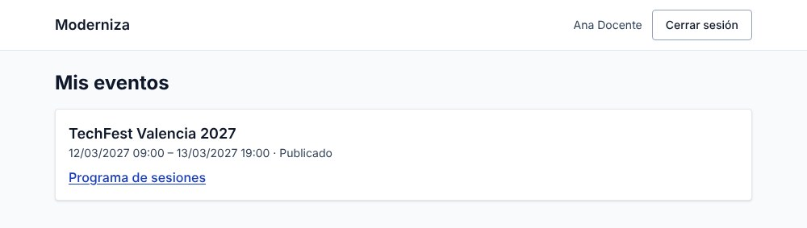
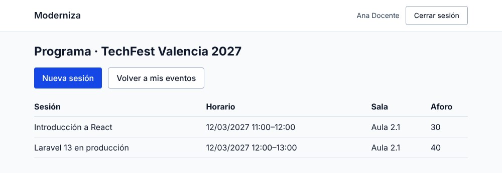
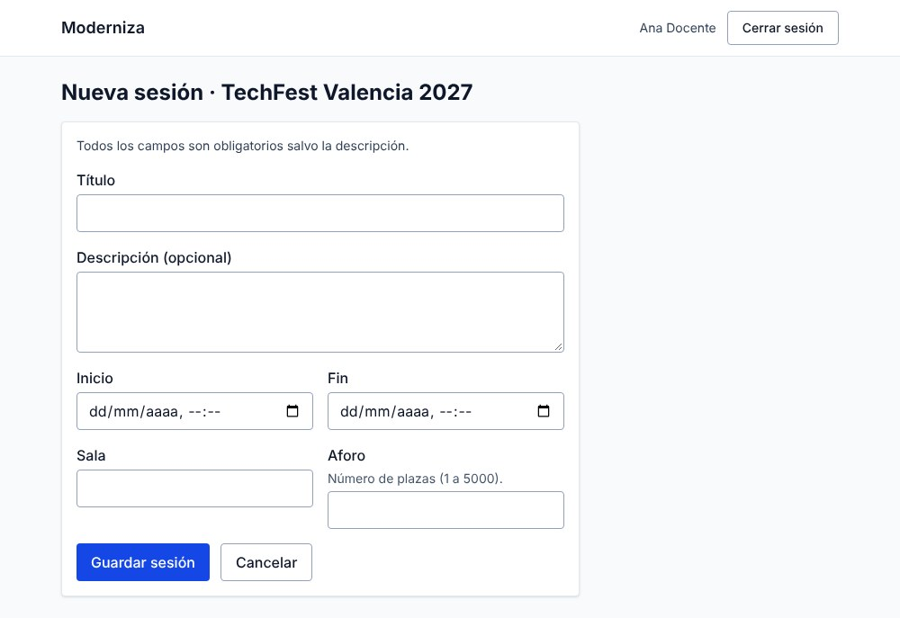
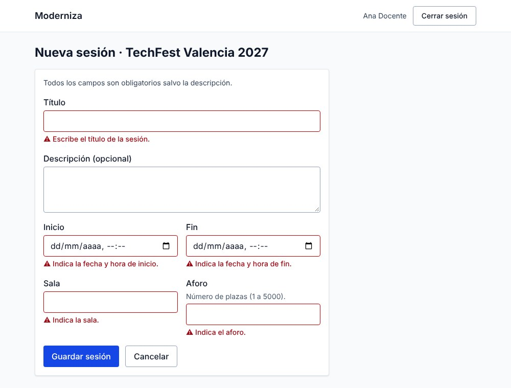
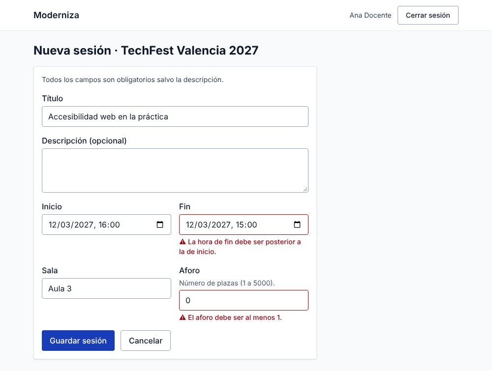
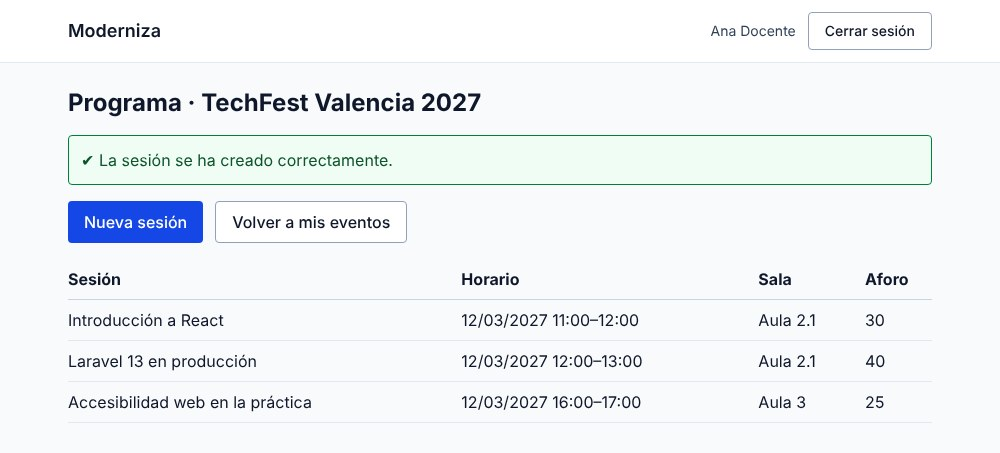

# Tarea 3 · Guía paso a paso

Esta guía os acompaña TODO a TODO. Para cada uno tenéis:

- **Qué hacer**: el objetivo en una frase.
- **Ejemplo en la plantilla**: código ya resuelto que se parece a lo que tenéis que escribir.
- **Pista**: el código con huecos (`___`). Rellenadlos; no lo copiéis sin entenderlo.
- **Comprueba**: la orden que os dice si está bien **antes** de pasar al siguiente.
- **Error típico**: lo que suele fallar y cómo arreglarlo.

Mirad primero cómo debe quedar (siguiente apartado). Haced los TODO **en orden** (T3-1 → T3-7). Cada comprobación solo necesita los TODO anteriores.

Todas las órdenes se ejecutan desde la carpeta raíz del repositorio (donde está `docker-compose.yml`).

---

## Así debe quedar

Estas capturas son de la solución, con datos ficticios. Muestran lo que tiene que hacer la aplicación cuando terminéis; los colores y estilos son los de la plantilla.

**1. Mis eventos** (ya viene hecha: es el ejemplo resuelto). Desde aquí se entra en el programa de cada evento.



**2. Programa de sesiones** (se abre cuando completáis T3-4). Lista las sesiones del evento y tiene el botón «Nueva sesión».



**3. Nueva sesión** (T3-6). Todos los campos tienen su etiqueta; la descripción es opcional.



**4. Formulario vacío** (T3-3 y T3-6). Al pulsar «Guardar sesión» aparece un mensaje junto a cada campo obligatorio.



**5. Datos incorrectos** (T3-3). Si la hora de fin es anterior a la de inicio o el aforo es 0, el mensaje explica el problema y **no se pierde lo escrito**.



**6. Datos correctos** (T3-5). Aparece «La sesión se ha creado correctamente» y la sesión nueva está en la lista.



---

## Antes de empezar

1. Arrancad todo: `docker compose up -d --build`.
2. Cread la base de datos de pruebas (solo la primera vez):
   - Linux, macOS, WSL o Git Bash:
     `docker compose exec -T db mysql -uroot -pyes < moderniza/docker/crear-bd-pruebas.sql`
   - Windows PowerShell:
     `Get-Content moderniza/docker/crear-bd-pruebas.sql | docker compose exec -T db mysql -uroot -pyes`
3. Abrid http://localhost:8000, iniciad sesión con vuestro organizador de Attendize y comprobad que aparece **Mis eventos**.
4. Buscad en el editor el texto `TODO T3-`: son los puntos que vais a completar.

**Comprueba:** `docker compose exec moderniza php artisan test --group=t3-1` se ejecuta y sale en **rojo** con mensajes «T3-1: falta…». Es lo normal: todavía no habéis empezado.

---

## T3-1 · La tabla `event_sessions` (migración)

**Archivo:** `moderniza/database/migrations/2026_11_01_000000_create_event_sessions_table.php`

**Qué hacer:** definir las columnas de la tabla nueva, sus claves externas hacia `accounts` y `events`, y un índice.

**Ejemplo en la plantilla:** las líneas `$table->id();`, `$table->boolean('is_published')…` y `$table->timestamps();` del mismo archivo.

**Pista:**

```php
$table->unsignedInteger('account_id');
$table->unsignedInteger('___');
$table->foreign('account_id')->references('id')->on('accounts')->cascadeOnDelete();
$table->foreign('___')->references('id')->on('___')->cascadeOnDelete();

$table->string('title', ___);
$table->text('description')->________();   // opcional
$table->dateTime('starts_at');
$table->dateTime('___');
$table->string('room', ___);
$table->unsignedInteger('___');

// (después de timestamps)
$table->index(['account_id', '___', '___']);   // cuenta, evento y fecha de inicio
```

**Comprueba:**

```bash
docker compose exec moderniza php artisan migrate
docker compose exec moderniza php artisan test --group=t3-1
```

Debe salir `DONE` en la migración y `OK (3 tests…)` en las pruebas.

**Error típico:** `Cannot add foreign key constraint` (o `errno: 150`). Habéis usado `foreignId()`, que crea una columna `BIGINT`, pero en Attendize `accounts.id` y `events.id` son `INT UNSIGNED`. Usad `unsignedInteger()` + `foreign()`. Si la migración ya se había ejecutado mal: `php artisan migrate:rollback` y otra vez `php artisan migrate`.

---

## T3-2 · Los modelos `EventSession` y `Event`

**Archivos:** `moderniza/app/Models/EventSession.php` y `moderniza/app/Models/Event.php`

**Qué hacer:**

1. Indicar qué campos se pueden rellenar desde el formulario (`$fillable`).
2. Convertir las fechas a fecha y el aforo a número (`casts()`).
3. Escribir la relación «un evento tiene muchas sesiones», ordenadas por hora de inicio.

**Ejemplo en la plantilla:** el método `casts()` de `Event.php` (convierte `start_date`, `end_date` e `is_live`) y la relación `account()` del mismo archivo.

**Pista:**

```php
// EventSession.php
protected $fillable = ['title', 'description', '___', '___', '___', '___'];
// account_id y event_id NO van aquí: los pone el servidor (T3-5).

return [
    'starts_at' => '________',
    'ends_at'   => '________',
    'capacity'  => '________',
];

// Event.php
public function sessions(): HasMany
{
    return $this->hasMany(________::class)->orderBy('________');
}
```

**Comprueba:** `docker compose exec moderniza php artisan test --group=t3-2` → `OK (3 tests…)`.

**Error típico:** `Return value must be of type HasMany, none returned`: falta el `return` en `sessions()`. Si el mensaje dice «account_id NO debe estar en $fillable», quitadlo: si estuviera, alguien podría enviar desde el navegador el `account_id` de otra cuenta.

---

## T3-3 · Las reglas de validación

**Archivo:** `moderniza/app/Http/Requests/StoreEventSessionRequest.php`

**Qué hacer:** escribir en `rules()` las reglas de cada campo. Los mensajes en español ya están hechos en `messages()`: fijaos en ellos, os dicen qué reglas hacen falta.

**Ejemplo en la plantilla:** el método `messages()` del mismo archivo (cada clave `campo.regla` corresponde a una regla).

**Pista:**

```php
return [
    'title'       => ['required', 'string', 'max:___'],
    'description' => ['________', 'string', 'max:5000'],
    'starts_at'   => ['required', '____'],
    'ends_at'     => ['required', 'date', '________:starts_at'],   // posterior al inicio
    'room'        => ['required', 'string', 'max:___'],
    'capacity'    => ['required', '_______', 'min:_', 'max:____'],
];
```

**Comprueba:** `docker compose exec moderniza php artisan test --group=t3-3` → `OK (2 tests…)`. Si falla, el mensaje dice qué dato se ha aceptado cuando debía rechazarse (por ejemplo, «capacity con decimales»).

**Error típico:** olvidar `nullable` en `description` (la descripción es opcional) o escribir `after:start_at` en lugar de `after:starts_at`.

---

## T3-4 · Solo eventos de mi cuenta (autorización)

**Archivo:** `moderniza/app/Http/Controllers/EventSessionController.php`, método `findOwnEvent()`

**Qué hacer:** buscar el evento por su id **dentro de la cuenta del usuario que ha iniciado sesión**. Si el evento es de otra cuenta, la respuesta debe ser 404 (no se revela que existe).

**Ejemplo en la plantilla:** `EventController::index()`, que lista solo los eventos de la cuenta con `ofAccount(...)`.

**Pista:**

```php
return Event::query()
    ->ofAccount($request->user()->________)
    ->whereKey($________)
    ->____________();   // si no lo encuentra, responde 404
```

**Comprueba:**

```bash
docker compose exec moderniza php artisan test --group=t3-4
```

`OK (2 tests…)`. En el navegador, desde **Mis eventos**, el enlace **Programa de sesiones** ya abre la página (antes salía `501 TODO T3-4`).

**Error típico:** usar `Event::find($eventId)` o `findOrFail($eventId)` sin filtrar por cuenta: funciona con vuestros eventos, pero también abre los de otras cuentas. La prueba «el evento de otra cuenta responde 404» lo detecta.

---

## T3-5 · Guardar la sesión y su ruta

**Archivos:** `EventSessionController::store()` y `moderniza/routes/web.php`

**Qué hacer:**

1. Añadir la ruta `POST /events/{eventId}/sessions`.
2. En `store()`: localizar el evento con `findOwnEvent()`, crear la sesión **solo con los datos validados**, poner `account_id` y `event_id` en el servidor, guardar y volver al listado con un mensaje.

**Ejemplo en la plantilla:** las dos rutas `GET` de sesiones que hay justo encima en `web.php`, y el método `create()` del controlador (usa `findOwnEvent()`).

**Pista:**

```php
// routes/web.php
Route::____('/events/{eventId}/sessions', [EventSessionController::class, '_____'])
    ->whereNumber('eventId')->name('events.sessions._____');

// EventSessionController::store()
$event = $this->findOwnEvent($request, $eventId);

$session = new EventSession($request->_________());
$session->account_id = $request->user()->account_id;
$session->event_id = $event->___;
$session->save();

return redirect()
    ->route('events.sessions.index', $event->id)
    ->with('success', 'La sesión se ha creado correctamente.');
```

**Comprueba:** `docker compose exec moderniza php artisan test --group=t3-5` → `OK (2 tests…)`. También podéis ver la ruta con `docker compose exec moderniza php artisan route:list --except-vendor`.

**Error típico:** `405 Method Not Allowed`: falta la ruta `POST` o tiene otro nombre. Si usáis `$request->all()` en lugar de `$request->validated()`, el navegador podría colar campos que no habéis validado.

---

## T3-6 · El formulario en React

**Archivo:** `moderniza/resources/js/pages/Sessions/Create.tsx`

**Qué hacer:** añadir los campos que faltan, enviar el formulario con Inertia y desactivar el botón mientras se guarda.

**Ejemplo en la plantilla:** el campo **Título** del mismo archivo (marcado como EJEMPLO RESUELTO). El componente `Field` ya asocia la etiqueta y el mensaje de error.

**Pista:**

```tsx
// Envío (dentro de submit)
post(`/events/${event.id}/sessions`, { preserveScroll: ____ });

// Un campo: copiad el de Título y cambiad lo necesario
<Field label="Inicio" id="starts_at" error={errors.________}>
    <input
        type="datetime-local"
        value={data.starts_at}
        onChange={(e) => setData('________', e.target.value)}
    />
</Field>
// Repetid con: Fin (ends_at, datetime-local), Sala (room, text, maxLength={80})
// y Aforo (capacity, type="number", min={1}, max={5000})

// Botón
<button type="submit" className="btn-primary" disabled={__________}>
    {processing ? 'Guardando…' : 'Guardar sesión'}
</button>
```

**Comprueba:**

```bash
docker compose exec moderniza-vite npm run types
```

Sin errores. Después, en el navegador: **Mis eventos → Programa de sesiones → Nueva sesión**:

- enviad el formulario vacío: aparece un error junto a cada campo obligatorio;
- poned fin anterior al inicio y aforo 0: errores claros y **no se pierde lo escrito**;
- datos correctos: aparece «La sesión se ha creado correctamente» y la sesión sale en la tabla.

**Error típico:** el campo se ve pero no se guarda: el `id` del `Field` o el nombre en `setData('...')` no coinciden con el de Laravel (`starts_at`, `ends_at`, `room`, `capacity`). Si `npm run types` dice que un nombre no existe en `SessionForm`, revisad cómo lo habéis escrito.

---

## T3-7 · Vuestras pruebas

**Archivo:** `moderniza/tests/Feature/CreateEventSessionTest.php`

**Qué hacer:** completar las dos pruebas marcadas con `TODO T3-7` (quitad la línea `markTestIncomplete`).

**Ejemplo en la plantilla:** la primera prueba del mismo archivo, `test_el_organizador_crea_una_sesion_en_su_evento` (EJEMPLO RESUELTO), y `ExampleEventsTest.php`.

**Pista:**

```php
// Datos inválidos
$user = User::factory()->create();
$event = Event::factory()->create(['account_id' => $user->account_id]);

$response = $this->actingAs($user)->post("/events/{$event->id}/sessions", array_merge($this->validData(), [
    'title' => '',
    'ends_at' => '2027-03-12 09:00:00',   // antes del inicio
    'capacity' => ___,
]));

$response->assertSessionHasErrors(['title', '_______', '________']);
$this->assertDatabaseCount('event_sessions', _);

// Otra cuenta
$user = User::factory()->create();
$otherEvent = Event::factory()->create();   // es de OTRA cuenta

$this->actingAs($user)
    ->post("/events/{$otherEvent->id}/sessions", $this->validData())
    ->________________();   // 404

$this->assertDatabaseCount('event_sessions', _);
```

**Comprueba:** `docker compose exec moderniza php artisan test` → todo en verde y **ninguna** prueba «incompleta».

**Error típico:** dejar la línea `$this->markTestIncomplete(...)`: la prueba nunca se ejecuta. Para comprobar que vuestra prueba sirve, quitad un momento la regla `after:starts_at` de T3-3: la prueba de datos inválidos debe ponerse en rojo. Después volved a ponerla.

---

## Al terminar

- [ ] `php artisan test`: todo en verde, ninguna incompleta.
- [ ] `npm run types`: sin errores.
- [ ] En el navegador: caso correcto, datos inválidos y URL de un evento de otra cuenta (404).
- [ ] `docker compose stop` y `docker compose start`: la sesión sigue ahí.
- [ ] Teclado (`Tab`) y vista móvil revisados.
- [ ] Pull Request con `Closes #n` integrada y etiqueta `tarea-03-entrega` subida.
